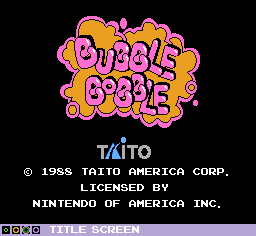

<div align="center">
   
</div>

## Description 
The specific project is a simple variation of an old video game Bubble Bobble developed in C++ using the <a href="https://cgaueb.github.io/sgg/index.html">SGG (Simple Game Graphics)</a> Library. It is a single player game, with the goal to collect all the gems without colliding with the enemies.

## Rules
- Press ENTER to start the game
- To move left and right you use the A and D keys and to jump W
- You have 5 lives
- You need to dodge the moving enemies
- If you lose all of the 5 lives, you lose the game
- The goal is to collect all the gems to win the game
- On the Game Over screen, press R to go back to the title screen
- Press 0 at any time to toggle the collision-box debug overlay

## How to Run

### Linux / macOS

```bash
git clone https://github.com/nayafyt/Bubble-Bobble.git
cd Bubble-Bobble

./scripts/setup-deps.sh    # fetches SGG and its dependencies into third_party/
make                       # builds bin/BubbleBobble
make run                   # plays it
```

`setup-deps.sh` clones the [SGG library](https://github.com/cgaueb/sgg) into
`third_party/sgg` (pinned to a known-good commit) and makes sure SDL2,
SDL2_mixer, GLEW, FreeType, GLM and OpenGL are available. If your system
already provides those, it uses them. If it does not, and you are on
Debian/Ubuntu, it unpacks a private copy into `third_party/local` **without
needing root** — nothing is installed system-wide.

To install the dependencies properly instead, before running the script:

| | |
|---|---|
| Debian/Ubuntu | `sudo apt-get install libsdl2-dev libsdl2-mixer-dev libglew-dev libfreetype-dev libglm-dev libgl-dev libglu1-mesa-dev` |
| Fedora | `sudo dnf install SDL2-devel SDL2_mixer-devel glew-devel freetype-devel glm-devel mesa-libGL-devel mesa-libGLU-devel` |
| Arch | `sudo pacman -S sdl2 sdl2_mixer glew freetype2 glm glu` |
| macOS | `brew install sdl2 sdl2_mixer glew freetype glm` |

Useful make targets:

| Target | What it does |
|---|---|
| `make` | build `bin/BubbleBobble` |
| `make run` | build, then run it from `bin/` |
| `make clean` | delete the build output |
| `make distclean` | also delete `third_party/` |
| `make deps` | run `scripts/setup-deps.sh` |

The game loads its assets through the relative path `assets/`, so it has to be
run with `bin/` as the working directory — `make run` does that for you.

### Windows (Visual Studio)

1. Build or download the SGG library for x64 and place it so that the solution
   can find it:
   - `include\sgg\graphics.h` and `include\sgg\scancodes.h` (already in the repo)
   - `lib\sgg.lib` (Release) and `lib\sggd.lib` (Debug)
   - the SGG DLLs (`SDL2.dll`, `SDL2_mixer.dll`, `glew32.dll`, `freetype.dll`, …)
     next to the executable in `bin\`
2. Open `Stage4.sln`, select the **x64** configuration and build.
3. Run from Visual Studio — the project is already set to use `bin\` as the
   working directory, which is where `assets\` lives.

## Project layout

```
BubbleBobbleGame/   game sources and the Visual Studio project
include/sgg/        SGG public headers (used by the Visual Studio build)
bin/assets/         sprites, fonts and sounds
scripts/            setup-deps.sh
Makefile            Linux/macOS build
third_party/        created by setup-deps.sh (not in git)
```
